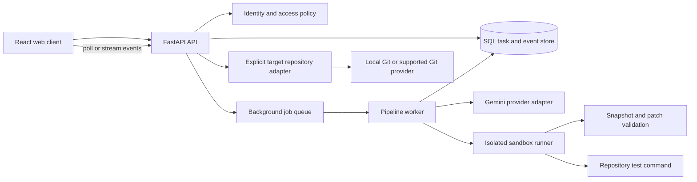

# RELAY AI Product and Engineering Blueprint

## Product outcome

RELAY AI accepts an engineering issue and a repository snapshot, produces a traceable proposed change, runs that change against the repository's tests in an isolated environment, presents evidence for a human decision, and performs only explicitly authorized repository operations.

## Product principles

1. Every task has a durable identity, status, timestamps, and append-only activity/evidence history.
2. AI output is untrusted input. Validate paths, patch scope, size, schema, and state transitions before acting on it.
3. A passing test run and reviewer recommendation are evidence, not automatic authorization.
4. Human approval is required before changing a target repository. Apply and commit must perform real Git operations and report their results.
5. Long-running work is asynchronous from the user's perspective: submit, receive task ID, watch progress, inspect result, decide.
6. Keep provider, persistence, sandbox, and API boundaries replaceable.

## Target architecture

### Component responsibilities

- **Web client:** report entry, ZIP upload, sample selection, task list/detail, stage timeline, diff and test/review evidence, and guarded approve/reject/apply/commit controls.
- **API:** validate requests, enforce authorization and state transitions, create/query tasks, accept actions, and expose health/readiness. It should not run model calls or tests in the request thread.
- **Task store:** durable task snapshots and append-only events, with transactional state changes and idempotency support.
- **Queue/worker:** execute triage, investigation, sandbox, and review; persist progress after each transition; support timeouts, cancellation, retries, and bounded concurrency.
- **Provider adapter:** Gemini structured-output calls, model/config selection, redacted errors, retry/rate-limit handling, token/cost telemetry, and a deterministic fake provider for local development.
- **Sandbox adapter:** validate a repository snapshot and patch, execute an allow-listed test command under resource/network limits, and capture bounded output and provenance. Production must not silently fall back to host subprocess execution.
- **Repository adapter:** bind a task to an explicit repository/worktree and base revision; re-check the base before apply; apply only the reviewed patch; create a real commit only after a separate explicit action.
- **Observability:** structured logs with task IDs, event history, health/readiness, metrics for queue latency, stage duration, failures, sandbox mode, and provider usage.

## Core task lifecycle

`RECEIVED -> QUEUED -> TRIAGING -> INVESTIGATING -> PATCH_READY -> SANDBOX_RUNNING -> REVIEWING -> AWAITING_APPROVAL -> APPROVED -> APPLIED -> COMMITTED`

Terminal/side states: `REJECTED`, `FAILED`, `CANCELLED`, and `EXPIRED`. Each transition must be centralized, validated, timestamped, and recorded as an event. Approval requires a patch, completed sandbox evidence, and a reviewer result; policy should require passing tests and no `FAIL` security assessment by default. Rejection is terminal. Apply requires approval and a matching repository/base revision. Commit requires a successful apply and an explicit commit message or documented generated message. Repeated actions must be idempotent or return a clear conflict.

## Main journeys

1. **Submit:** enter a report and upload/choose a repository snapshot; validate size/type/path limits; return task ID immediately.
2. **Follow progress:** task detail refreshes from persisted stage/event state; failures include safe diagnostics and a retry option where appropriate.
3. **Review result:** inspect triage, root cause, changed files, unified diff, patch validation, test command/output, reviewer verdict, and risks.
4. **Decide:** reject with notes or approve after reviewing evidence.
5. **Apply:** select/confirm an authorized target worktree; verify base revision and clean state; apply patch; record resulting revision.
6. **Commit:** separately confirm commit; create a real Git commit; persist actual hash and message.
7. **Operate:** list/search/filter tasks; retain and delete task data according to documented policy; inspect event/audit history.

## API contract direction

- `POST /api/v1/tasks` creates a task from JSON or multipart upload and returns `202` plus task ID.
- `GET /api/v1/tasks` lists authorized tasks with pagination and filters.
- `GET /api/v1/tasks/{id}` returns task state and result references.
- `GET /api/v1/tasks/{id}/events` streams or pages the persisted event timeline.
- `POST /api/v1/tasks/{id}/actions` accepts validated approve, reject, apply, commit, cancel, or retry commands with idempotency key.
- `GET /api/v1/scenarios` returns demo inputs; `GET /health` and `/ready` distinguish liveness from dependency readiness.

Keep current endpoints temporarily as compatibility aliases during migration.

## Data model direction

- **Task:** ID, owner, input metadata, status/current stage, model and policy version, timestamps, error summary, repository reference and base revision.
- **Task input:** report and bounded file/snapshot references; avoid duplicating large source payloads in event records.
- **Stage result:** triage, patch metadata/diff, sandbox execution evidence, reviewer assessment.
- **Task event:** immutable sequence number, timestamp, actor, stage, transition, safe details, correlation ID.
- **Action record:** actor, action, notes, idempotency key, outcome, timestamp.
- **Repository operation:** target reference, before/after revision, command/result, commit metadata.

Secrets, raw credentials, and unnecessary source contents must not be copied into logs or model error responses.

## Security and reliability requirements

- Configure explicit CORS origins; add authentication and per-task authorization before any shared deployment.
- Enforce request, archive, expanded archive, file-count, file-size, path-depth, and model-context limits.
- Canonicalize archive paths; reject absolute paths, traversal, symlinks, duplicate normalized paths, and unsafe file types.
- Treat prompt contents and generated diffs as untrusted. Verify every changed path belongs to the supplied snapshot and enforce changed-file limits.
- Execute code only in a hardened isolated runtime with no host secrets, no network by default, read-only inputs, resource limits, and bounded logs. Fail closed if required isolation is unavailable.
- Restrict test commands to configured argv profiles; never concatenate untrusted command strings into a shell.
- Use durable storage, task leases, bounded retries, timeouts, idempotency, and recovery of abandoned work.
- Apply/commit only against an authorized explicit target and expected base revision; audit all actions.
- Define retention/deletion, backup, and source-code handling policies before production use.

## Delivery roadmap and acceptance gates

### Phase 0 — Make the current backend truthful and usable
- Correct Gemini SDK call; document required configuration and failures.
- Add policy/state checks so failed tests or a rejecting reviewer cannot be approved by default.
- Harden ZIP and workspace path handling and add strict upload limits.
- Make action names and docs honest: either implement repository apply/commit with a target worktree or disable them until that adapter exists.
- Add deterministic fake-provider injection so pipeline behavior is usable without paid model calls.
- Gate: pipeline and action behavior verified with focused automated checks; no test execution is claimed until run.

### Phase 1 — Durable asynchronous backend
- Introduce database-backed task/event persistence and schema migrations.
- Split submission from worker execution; expose progress polling/events, cancellation, retry, and pagination.
- Add structured logging, readiness, bounded retries, and operational configuration.
- Gate: restart recovery, concurrent tasks, event ordering, and failure recovery verified.

### Phase 2 — Safe execution and repository operations
- Build hardened sandbox adapter and configurable test profiles.
- Store immutable input snapshot and base revision; validate patch scope.
- Implement target worktree apply and real commit adapter with explicit authorization and conflict handling.
- Gate: isolation checks, hostile archive/patch cases, stale-base rejection, and real Git integration verified.

### Phase 3 — Complete web product
- Build responsive task submission, task list/detail, event timeline, diff viewer, evidence panels, and action flow.
- Connect the UI to versioned API and surface loading, failure, empty, and retry states.
- Gate: end-to-end user journey from submit through review and authorized repository action verified.

### Phase 4 — Production readiness
- Add authentication/authorization, rate limiting, retention controls, metrics/tracing, deployment configuration, backups, and incident/runbook documentation.
- Run security review, load checks, accessibility review, and provider failure exercises.
- Gate: documented threat model, SLOs, recovery procedures, and operational ownership.

## Current scope and assumptions

- Build in small reviewable increments, preserving a working local demo.
- Python FastAPI remains the first backend; React/Vite remains the web client.
- Gemini remains the initial model provider behind an adapter boundary.
- SQLite is suitable for an initial durable local deployment; production database/queue choices should be made before multi-instance deployment.
- Applying changes to an external or arbitrary user repository is disabled until an explicit repository binding and authorization model exists.
